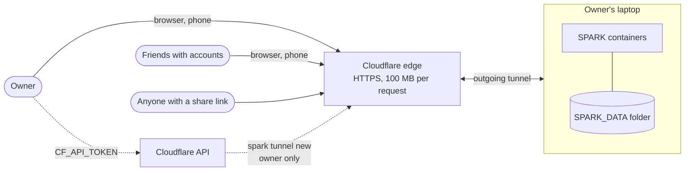
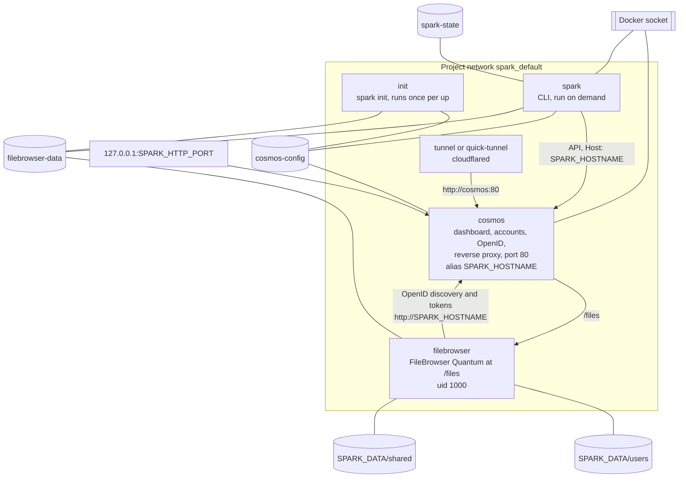
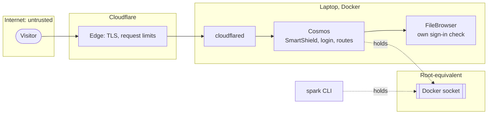
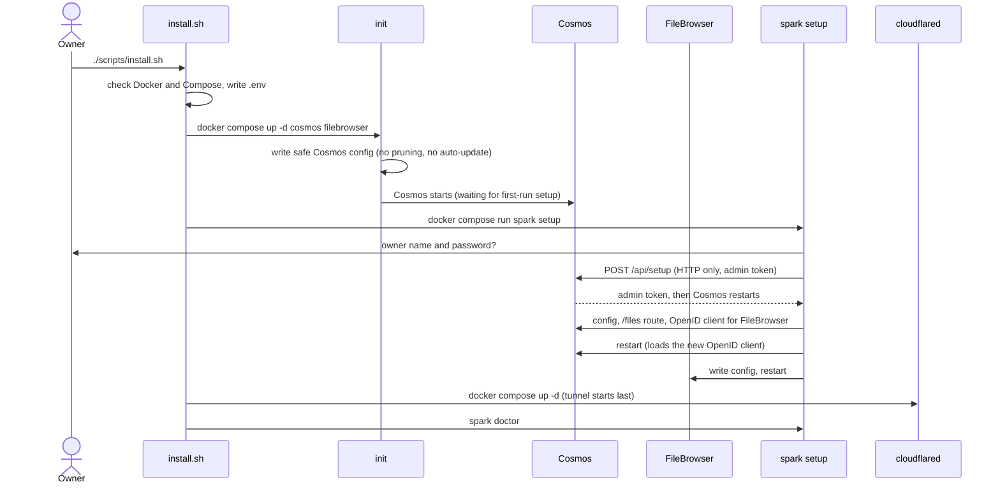
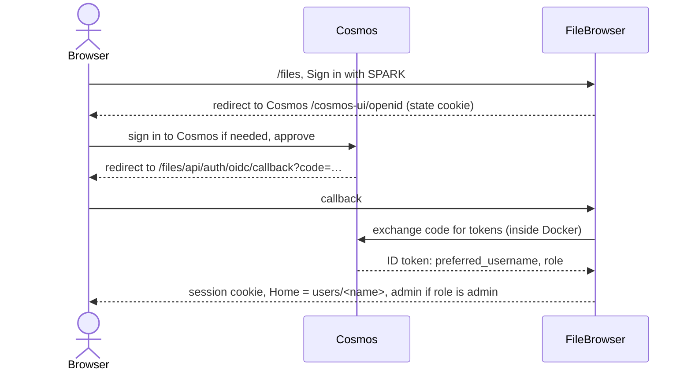
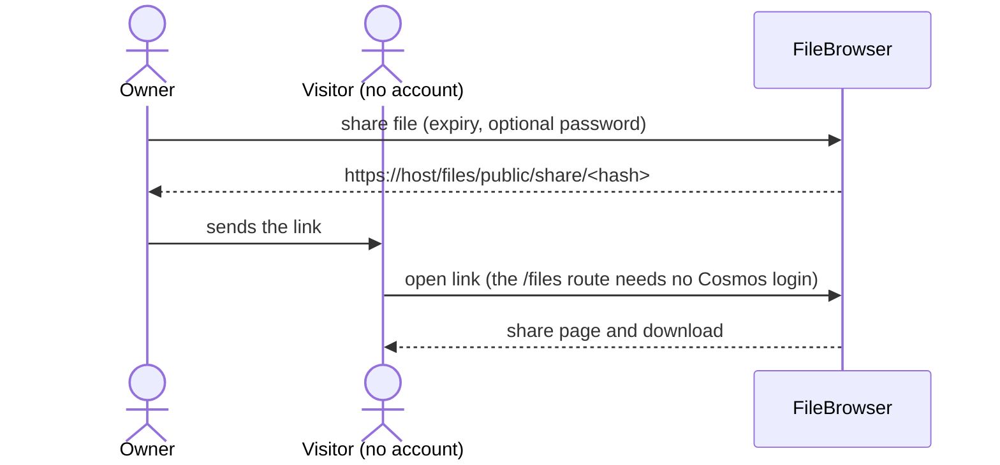
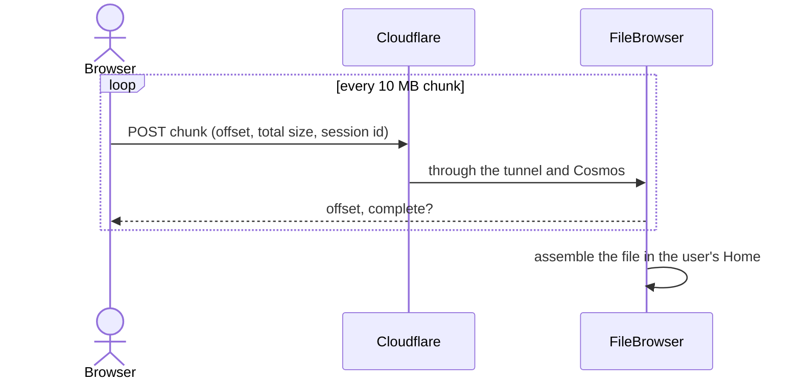
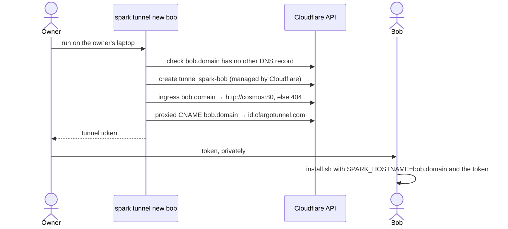
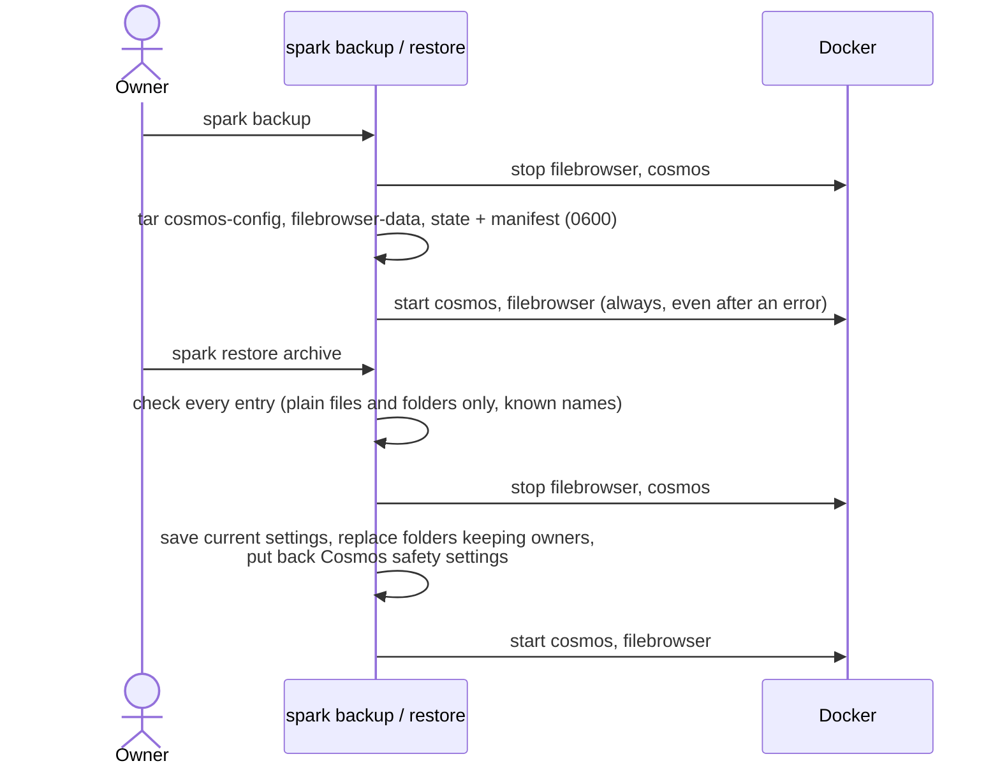

# SPARK architecture

SPARK is a Docker Compose project. A few containers on a Linux laptop give a dashboard with
accounts, a file manager, and a public address through a Cloudflare Tunnel, with no router ports
opened. Everything is ordinary containers, named volumes and one data folder. Why things are this
way is in [design.md](design.md); the interfaces the code relies on are in
[development.md](development.md).

## System context



## Containers, volumes and network



| Service | Image | Role |
|---|---|---|
| `init` | `spark-cli:local` (built here) | Writes Cosmos's safe config before Cosmos ever starts, makes the data folders, writes a placeholder FileBrowser config. No Docker socket. |
| `cosmos` | `azukaar/cosmos-server:0.23.4` | Dashboard, accounts and two-factor, OpenID provider, reverse proxy. HTTP only; TLS ends at Cloudflare. The only service with a published port. |
| `filebrowser` | `gtstef/filebrowser:2.0.2-stable` | Files at `/files`, signs in through Cosmos (OpenID). |
| `tunnel` / `quick-tunnel` | `cloudflare/cloudflared:2026.10.0` | Outgoing tunnel to Cloudflare (profile `tunnel` with a token, or `quick-tunnel` for a random test address). |
| `spark` | `spark-cli:local` | `setup`, `user`, `tunnel`, `doctor`, `backup`, `restore`. |

Settings, accounts and secrets live in named volumes (`cosmos-config`, `filebrowser-data`,
`spark-state`). People's files live only in `SPARK_DATA`:

```
SPARK_DATA/
├── users/<name>/     each account's Home in Files
├── shared/           Shared (read-only in Files)
├── media/            for Jellyfin (add-on)
├── apps/             data of apps installed from Cosmos's app store
└── backups/          spark backup archives
```

## Trust boundaries



- Only Cosmos publishes a port, on `127.0.0.1` by default. FileBrowser is reachable only
  through Cosmos.
- Cosmos trusts `X-Forwarded-For` only from the project network (cloudflared), so its brute-force
  protection sees real visitors.
- Cosmos holds the Docker socket, which is root-equivalent. Its pruning and self-update are
  turned off by SPARK's config and checked by `spark doctor`. The owner account should use
  two-factor login.
- Secrets: `.env` (git-ignored) holds the tunnel token and, on the owner's machine, the Cloudflare
  API token. The Cosmos admin token and FileBrowser's sign-in secret live in volumes, mode 0600.

## Hostnames

One address per install; apps live on paths. Cloudflare's free certificate covers one level below
the domain, so `files.bob.example.com` would fail; `bob.example.com/files` works.

| Mode | `SPARK_HOSTNAME` | Scheme | Notes |
|---|---|---|---|
| Own domain | `spark.yourdomain.com` | https (Cloudflare) | tunnel made with `spark tunnel new` |
| Friend's domain | `bob.friend-domain.com` | https | the friend runs `spark tunnel new bob` |
| Test | (empty; read from quick-tunnel logs) | https | random, public while it runs |
| Laptop only | `spark.localhost` | http | port 80; browsers send `*.localhost` to the laptop itself |

Inside Docker the `cosmos` container also answers to the hostname (network alias), so FileBrowser
reaches Cosmos's OpenID endpoints directly, never through the internet.

## Install



Nothing is public until the owner account exists: the tunnel starts after setup. (Quick-tunnel
mode starts its tunnel first, because setup needs the random address.)

## Signing in to Files



FileBrowser builds the callback address from the headers Cosmos sends; the `/files` route adds
`X-Forwarded-Proto: https` because TLS ends at Cloudflare.

## Share links



## Large uploads



Cloudflare refuses requests over 100 MB, so FileBrowser's web page sends big files in 10 MB pieces.

## A friend gets an address on the owner's domain



## Backup and restore



Backups hold settings, accounts and secrets, not people's files in `SPARK_DATA`.

## Known limits

- 5 accounts per install (Cosmos free tier); share links need no account.
- Uploads through Cloudflare are cut into chunks of at most 100 MB (FileBrowser uses 10 MB).
- Cloudflare's free plan forbids serving mostly video; media (Jellyfin) stays off the tunnel.
- Cosmos and FileBrowser Quantum are each maintained by one person; versions are pinned and tested
  on a throwaway install before upgrading.
